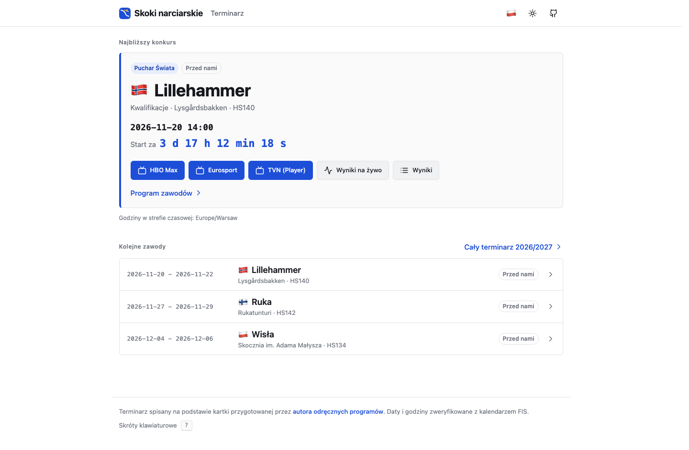
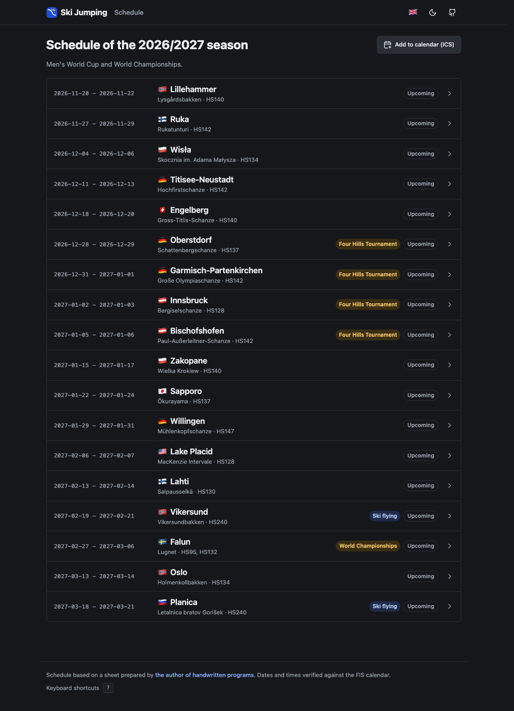

# Skoki narciarskie ⛷️

Terminarz Pucharu Świata w skokach narciarskich z linkami do transmisji i wyników na żywo. Jedna strona, na której od razu widać, kiedy jest najbliższy konkurs, gdzie go obejrzeć i gdzie śledzić wyniki.

## Co potrafi ✨

- ⏱️ Najbliższy konkurs z odliczaniem do startu _(także kwalifikacje i konkursy drużynowe)_
- 🗓️ Terminarz całego sezonu: Puchar Świata mężczyzn, Turniej Czterech Skoczni, loty i Mistrzostwa Świata
- 📺 Linki do polskich nadawców przy każdym konkursie
- 📊 Linki do wyników na żywo i wyników końcowych w serwisie FIS
- 🌍 Godziny w strefie czasowej widza _(przeliczane w przeglądarce)_
- 📅 Kalendarz sezonu do subskrypcji w formacie ICS
- 🇵🇱 Dwie wersje językowe: polska i angielska
- 🌗 Motyw jasny i ciemny
- ⌨️ Skróty klawiaturowe _(ściąga pod `?`)_

## Skąd są dane 📋

Punktem wyjścia jest odręczny program sezonu przygotowany przez [autora kartek z terminarzem](https://www.facebook.com/profile.php?id=100064595445494). Daty, rodzaje konkursów i godziny startu są zweryfikowane z kalendarzem [FIS](https://www.fis-ski.com/DB/ski-jumping/calendar-results.html).

## Rozwój 🛠️

Instrukcja uruchomienia, opis danych i sposób dodawania kolejnych sezonów są w [CONTRIBUTING.md](CONTRIBUTING.md).

## Licencja 📄

[The MIT License](https://piecioshka.mit-license.org) @ 2026
