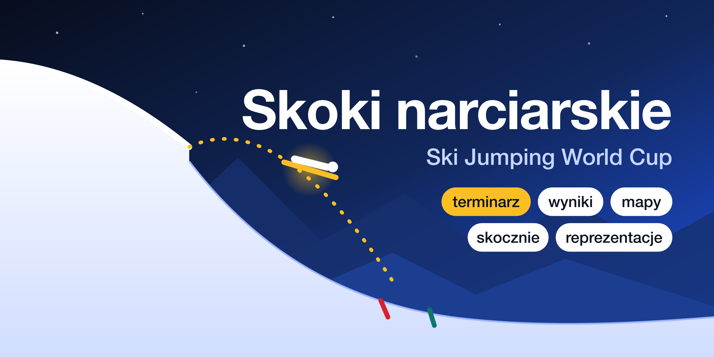

# Skoki narciarskie ⛷️

Serwis kibica Pucharu Świata w skokach narciarskich: kiedy jest najbliższy konkurs, gdzie go obejrzeć, kto prowadzi w klasyfikacji i na jakiej skoczni skaczą. Po polsku i po angielsku.

**[piecioshka.github.io/skoki-narciarskie](https://piecioshka.github.io/skoki-narciarskie/)**

## Co potrafi ✨

- ⏱️ Najbliższy konkurs z odliczaniem do startu _(także kwalifikacje i konkursy drużynowe)_
- 🗓️ Terminarz sezonu: Puchar Świata mężczyzn i Mistrzostwa Świata, z programem każdych zawodów
- 📺 Linki do polskich nadawców i do wyników na żywo w serwisie FIS
- 🗄️ Archiwum poprzednich sezonów z podium każdego konkursu
- 📖 Zasady skoków objaśnione na schematach
- 🏆 Klasyfikacja generalna od sezonu 2000/2001 _(z filtrem "Tylko Polacy")_
- 🥇 Profile turniejów: Turniej Czterech Skoczni, Raw Air, Planica7 i inne, z zasadami i zwycięzcami
- 🏔️ Profile skoczni ze zdjęciem: punkt K, rozmiar, rekord, parametry profilu, ciekawostki i rozegrane konkursy
- 🗺️ Mapy miejsc zawodów i wszystkich skoczni
- 🌐 Strony reprezentacji: punkty, trofea i wyniki drużynowe zawodników każdego kraju
- 🧑‍🏫 Kadry i sztaby szkoleniowe 11 reprezentacji
- ⚖️ Sędziowie i delegaci techniczni zawodów
- 🖼️ Galeria odręcznych programów na każdy weekend
- 🌍 Godziny w strefie czasowej widza _(przeliczane w przeglądarce)_
- 📅 Kalendarz sezonu do subskrypcji w formacie ICS
- 🌗 Motyw jasny i ciemny
- ⌨️ Skróty klawiaturowe _(ściąga pod `?`)_

## Skąd są dane 📋

- terminarz, godziny, klasyfikacje i sędziowie: [FIS](https://www.fis-ski.com/DB/ski-jumping/calendar-results.html)
- kadry Polski: [Polski Związek Narciarski](https://www.pzn.pl/skoki-narciarskie)
- skocznie: [skisprungschanzen.com](https://www.skisprungschanzen.com/)
- turnieje: Wikipedia
- zdjęcia: Wikimedia Commons, z listą autorów na stronie "Autorzy zdjęć"
- odręczne programy: [autor kartek z terminarzem](https://www.facebook.com/profile.php?id=100064595445494)

## Rozwój 🛠️

Instrukcja uruchomienia, opis danych i sposób dodawania kolejnych sezonów są w [CONTRIBUTING.md](CONTRIBUTING.md).

## Licencja 📄

[The MIT License](https://piecioshka.mit-license.org) @ 2026
